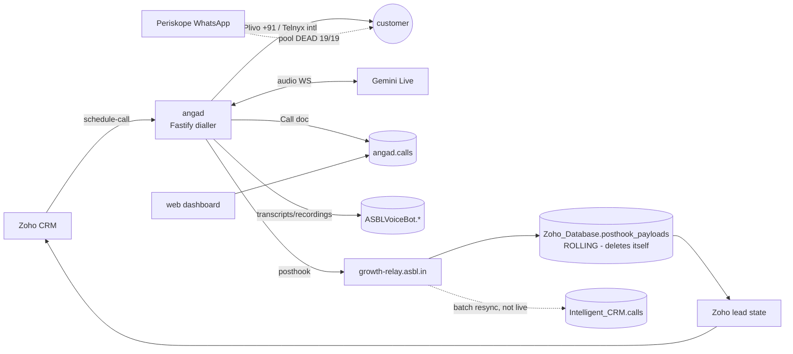

# ANGAD — Architecture & Schema Audit (as-is)

*The review a senior voice-agent backend engineer would give this system.
Every finding below was **measured on the live data** during this engagement —
nothing is speculation. Where a number appears, we computed it.*

Signature: CI Team — citeam.claudemax@gmail.com · Built with Claude (Anthropic)
Scope: clusters original → growth-test → growth-prod; DBs `angad`,
`ASBLVoiceBot`, `Zoho_Database`, `Intelligent_CRM`. Read-only throughout.

---

## Verdict

A capable production system built at speed, carrying the classic debts of
speed: **one call is described by six stores with four different outcome
vocabularies and no single source of truth; identity is keyed three different
ways; the highest-value telemetry (latency, hangup cause, AMD, prompt version)
is logged to console and lost; and two collections silently destroy or
unboundedly accumulate history.** The 2026-08 migration fixed real things
(webhook target, indexes, read-only credentials) and proved the team can move
carefully — the same care now needs to reach the data model. None of this is
rare; all of it is fixable incrementally (see TARGET_ARCHITECTURE.md).

## The system, as it actually is

## Findings ledger (evidence attached)

### A. Identity — one human, three keying systems
| # | Finding | Evidence | Severity |
|---|---|---|---|
| A1 | Person identity keyed 3 ways: raw phone (angad/ASBLVoiceBot), MLID (registries/persons), PLID (person×project) — every cross-store join starts with phone-string gymnastics | formats `+91…`/`91…`/bare coexist; the dictionary itself prescribes "strip to last 10" | high |
| A2 | **Phone number used as `_id`** in 4+ collections (whatsapp_messages, mlid_registry ×2, reactivation_list, sender maps) — PII as primary key, unrotatable, spread by every backup | observed in all three clusters | high |
| A3 | The ops workbooks' phone column is masked → analytics must bridge through MLID → Zoho export; fragile | AI-Leads sheet: 63 distinct values across 3,352 rows | medium |

### B. The call record — six stores, four vocabularies, no owner
| # | Finding | Evidence | Severity |
|---|---|---|---|
| B1 | One dial writes to 6 stores (calls, call_schedules, call_transcripts, call_recordings, posthook, CRM calls) with **no transactional or reconciled relationship** | pipeline match rates measured pre-cutover: 97% / 42.8% / 39.4% / 5.9% / 12.2% | critical |
| B2 | **Four outcome vocabularies** for the same fact: `CALL_OUTCOMES` (12), `source_raw_outcome` (17 raw codes), Intelligent_CRM `outcome` (5) + `disposition` (5), Zoho `call_status` (3) — every consumer maintains its own mapping | enumerated from live data | high |
| B3 | Pre-cutover, **87.8% of dials never reached the CRM** (66% of BOOKED calls blind) → CRM re-dialled booked/DNC customers (825 / 308 measured events). Webhook now repointed — **must be re-measured on growth-prod after a full week** | three-way trace | critical (mitigated, unverified) |
| B4 | `posthook_payloads` is a **rolling window that deletes its own history** (2,941 → 2,525 → 2,471 observed across three days). Any consumer that misses a window misses forever | measured shrinkage on the SOURCE cluster | high |

### C. Telemetry that exists but is thrown away
| # | Finding | Evidence | Severity |
|---|---|---|---|
| C1 | Per-call **latency** (ws→first-audio), **carrier hangup cause**, **AMD human/machine result**, **prompt version**, **provider** — all console-logged, none persisted | the QA sheet blames "11s latency" for lost customers; the data cannot confirm or deny | critical |
| C2 | Result: "why did they drop — technical or call failure?" is **unanswerable from data**; our drop-stage analytics are inference from transcript shape | stated on-dashboard | — |

### D. Schema hygiene
| # | Finding | Evidence | Severity |
|---|---|---|---|
| D1 | Mixed types in one field: `created_at`/`updated_at` string-in-some-docs, datetime-in-others | broke 5 of our parquet writes until type-sniffing added | medium |
| D2 | Unbounded in-document growth: `transcript[]` + `fullText` inside the call doc; `webhookDeliveries[]`; `lead_journeys.calls[]` (one lead: **204 entries**); `whatsapp_messages.by_date{}` map | measured maxima | high at 10x |
| D3 | Duplicate truth for leads across 4 stores (angad.leads / Zoho leads / crm_leads / persons) with agent-vs-web schema copies that must drift | dictionary's own warning + observed | medium |
| D4 | `stuck_sends` grows without bound (28k → 32k in days; +1,674 in one afternoon) — failure queue with no reaper | measured | medium |
| D5 | Plaintext secrets in data collections (`webhooks.secret`, `bot_settings.zoho_access_token_v1`) readable by any read credential | observed (values masked in our tooling) | high |

### E. Behavioral bugs proven in data
| # | Finding | Evidence | Severity |
|---|---|---|---|
| E1 | **Night-defer gate leaks** — ~10.3k dials outside 09–21 IST historically; **reproduced on growth-prod's first live morning (9 of 41 dials)**. Survived the migration | measured 2026-08-07 | critical (TRAI) |
| E2 | Scheduler "ghost" completions: 3,561 night_defer rows marked done whose dialledCallId matches no call record | measured | high |
| E3 | Cadence excess: 12,970 redials <60min; 35,238 same-day 3+ dials; one lead dialled 204 times | measured | high |
| E4 | WhatsApp sender pool 19/19 permanently dead; 28,309 undelivered sends while "sent" flags read true | measured | critical |

## What breaks at scale (ranked by what fails first)

1. **Working set blowup from fat call docs** — transcript + fullText + slots
   inside `angad.calls`. At 10x (~450k calls) the hot collection carries GBs of
   text through every scan; count/aggregate queries (the dashboard-snapshot
   pattern that already needed precomputing once) degrade first. *Fix: move
   conversation text out of the hot doc (B-tier store / archive), keep the doc
   an event summary.*
2. **`lead_journeys.calls[]` and `whatsapp_messages.by_date{}`** — per-entity
   arrays/maps that grow with activity. The 204-call lead is a 10x preview:
   16MB document cap is reachable, and every update rewrites the whole array.
   *Fix: one-row-per-event collections (Intelligent_CRM.lead_events already
   models this correctly — extend it, delete the rollups).*
3. **stuck_sends / cron_log style append-only queues with no TTL** — millions
   of rows in months; backups and index maintenance pay for garbage. *Fix: TTL
   or archive-and-truncate.*
4. **Rolling-delete posthook window** — at higher call volume the window
   shortens in wall-clock terms; any consumer outage = permanent data loss.
   *Fix: retention belongs in an archive tier, not in silent deletes.*
5. **Serverless CRM writers against Atlas** (legacy pattern) — connection
   storms under burst; the new relay must use pooled connections.
6. **Four-vocabulary outcome mapping** — every new consumer multiplies mapping
   bugs; at scale this is where silent misclassification comes from.

## Priority fixes (owner-mapped)
1. Persist C1 fields on the call doc — *agent team, small change, unblocks
   root-cause analytics forever*.
2. Fix night-defer gate (E1) + add a compliance assertion at dial time —
   *agent team; TRAI exposure*.
3. One canonical outcome enum + versioned mapping table (B2) — *platform*.
4. Replace WhatsApp pool + persist delivery status (E4) — *ops + platform*.
5. Retention policy: kill rolling deletes, archive tier (B4, D4) — *platform*.
6. Slim the call doc; event-per-row for journeys (scale items 1–2) — *platform,
   before any 10x push*.

*Post-cutover verification due after one week of growth-prod traffic: re-run
the pipeline trace (expect posthook/CRM match rates to jump from 5.9%/12.2%
toward ~100% for outcome-bearing calls). The dashboard's Audit tab computes
this on every sync.*
