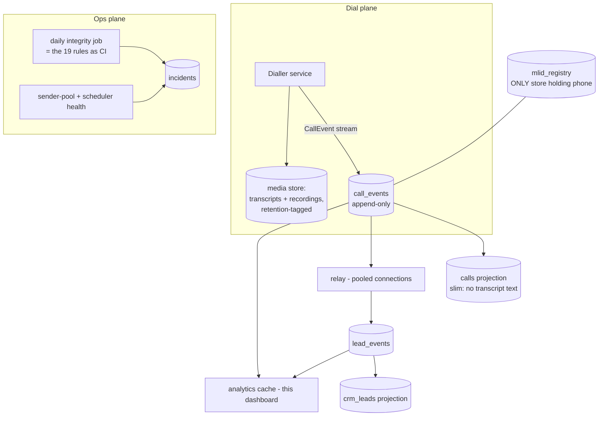

# ANGAD — Target Architecture (to-be)

*The reference design your team can implement incrementally. Every element
answers a measured defect in ARCHITECTURE_AUDIT.md. Written to be handed to a
developer who has never seen this system.*

Signature: CI Team — citeam.claudemax@gmail.com · Built with Claude (Anthropic)

---

## Design principles
1. **One fact, one owner.** Every fact (a call happened, a visit was booked,
   a person opted out) has exactly one authoritative store; everything else is
   a projection that can be rebuilt.
2. **Events first.** Append-only events; current-state documents are derived.
   `Intelligent_CRM.lead_events` already does this correctly — it becomes the
   spine, not a side-car.
3. **Idempotent everywhere.** Deterministic event ids; consumers can replay.
4. **Telemetry is data.** If the agent can log it, the agent persists it.
5. **PII minimization at the edge.** Phone lives in ONE registry; all
   analytics key on MLID. Voice/text content carries retention clocks.
6. **Nothing deletes silently.** Retention = archive tier, never in-place loss.

## Target system



## 1. The call ledger (fixes B1, B3, C1, D2)
`call_events` — append-only, one row per lifecycle event, deterministic
`_id = <call_uuid>:<event_type>`:

```
{ _id, call_uuid, mlid, plid, provider: plivo|telnyx, engine, direction,
  type: scheduled|dialing|answered|amd_result|first_audio|interrupted|
        tool_call|hangup|outcome|webhook_delivered|webhook_failed,
  ts, seq,
  data: {
    // REQUIRED on the relevant events - the fields lost today:
    latency_first_audio_ms, amd: human|machine|unknown,
    hangup_cause,            // carrier's own code, verbatim
    prompt_slug, prompt_version, model_id,
    outcome,                 // THE canonical enum, nothing else
    duration_ms, tokens: {...}
  } }
```
- `calls` becomes a **slim projection** (no transcript/fullText text) rebuilt
  from events; conversation text lives in the media store with a retention tag.
- Indexes: `{call_uuid, seq}`, `{mlid, ts}`, `{type, ts}`, `{ts}`.

## 2. One outcome enum (fixes B2)
A single versioned table `outcome_map(source_system, raw_value) → canonical`.
Canonical set (v1): `BOOKED_SITE, BOOKED_VIRTUAL, CONNECTED, CALLBACK,
NOT_INTERESTED, DNC, DROPPED, NO_ANSWER, BUSY, VOICEMAIL, SWITCHED_OFF,
NOT_CONNECTED, FAILED`. Consumers may only read canonical. Changing the map is
a versioned migration, never an inline edit.

## 3. Identity spine (fixes A1–A3)
- `mlid_registry` is the ONLY collection storing a phone number; `_id = MLID`
  (never the phone), unique index on normalized phone.
- Every other store carries `mlid` (+ `plid` where project-scoped).
- Normalization function published as a shared lib (last-10, one place).
- Ops exports carry MLID, never phone → the masked-column problem disappears.

## 4. CRM ingestion (fixes B3, B4)
- Relay consumes `call_events` (outcome + booking events) → appends
  `lead_events` with deterministic ids → projections update. Pooled
  connections, retry with idempotency, delivery state persisted per event.
- The batch resync dies. `posthook_payloads` becomes an archive table with
  **no deletes**; retention moves to the archive tier (below).

## 5. Retention & archive (fixes B4, D4, scale 3–4)
- Hot stores keep 90 days. A nightly job exports older rows to parquet in
  object storage (the exact format this dashboard already consumes).
- `stuck_sends`, `cron_log`: TTL 30 days after archive.
- Voice recordings: retention clock per TRAI/consent policy; delete on expiry
  from the media store (the ONLY place they exist).

## 6. Compliance at the edge (fixes E1, E3)
The dialler asserts BEFORE dialing (not after):
- window: 09:00–21:00 in the CUSTOMER's timezone (provider prefix → tz);
- suppression: DNC flag, active-booking flag, attempt caps
  (≤3/day, ≤N lifetime, ≥60min gap unless callback-requested);
- every refusal emits a `dial_suppressed` event with the reason — so the
  Integrity dashboard reads suppressions, not violations.

## 7. Channel health (fixes E4)
- Sender pool: heartbeat per sender; `delivery_status` persisted per message
  (sent/delivered/failed+error); pool exhaustion = paging alert, not a silent
  31k-row queue.

## 8. Observability (makes the audit permanent)
- `incidents` collection: every alert the system fires, persisted.
- **The 19 integrity rules run as a nightly job** against production (they are
  pure reads — this dashboard's `build_integrity` is the reference
  implementation) writing per-day violation counts → trend, not archaeology.
- Weekly pipeline-trace job asserts ≥99% event-to-CRM match for
  outcome-bearing calls.

## 9. Scale-out blueprint (executes the SANKALPA scaling protocol upstream)
| Trigger | Action |
|---|---|
| calls > 500k | move transcript text out of hot docs (if not already), enable archive tier |
| dial rate 10x | shard `call_events` by month; readers unchanged (query by ts) |
| multi-project | tenant key on every event; per-tenant registries; same codebase |
| analytics load | read-only analytics replica / Atlas analytics node; this dashboard points there |

## 10. Migration order (safe, incremental — no big bang)
1. Agent persists the C1 fields on the EXISTING call doc (additive, zero risk).
2. Stand up `call_events` alongside; dual-write from the agent (additive).
3. Relay switches to consuming events; retire batch resync.
4. Slim `calls` (stop writing transcript text into it; backfill archive).
5. Introduce outcome_map; consumers migrate read paths; freeze legacy enums.
6. MLID-only keys in new writes; registry becomes sole phone holder;
   background re-key of historical stores.
7. Retention/TTL jobs; compliance-at-edge asserts; health/incidents.
Each step is independently shippable and reversible.

## 11. Replicating the analytics stack (for any environment)
Components (this repo): `sync.py` (read-only extract → pseudonymised parquet),
`pii.py` (one-way identity), `readonly.py` (write-impossibility guard),
`audit_pii.py` (leak scanner), `dashboard.py` + `page.html` (local server),
`exec_report.py`, `compare_clusters.py` (migration forensics),
PROTOCOL_SANKALPA.md (operating rules + scaling runbook).
Bring-up: read-only URI in `.env` → `test_connection` → `sync --full` →
`audit_pii` (must be CLEAN) → `dashboard`. PII regime and the write-guard are
not optional components; they are the licence to operate.
